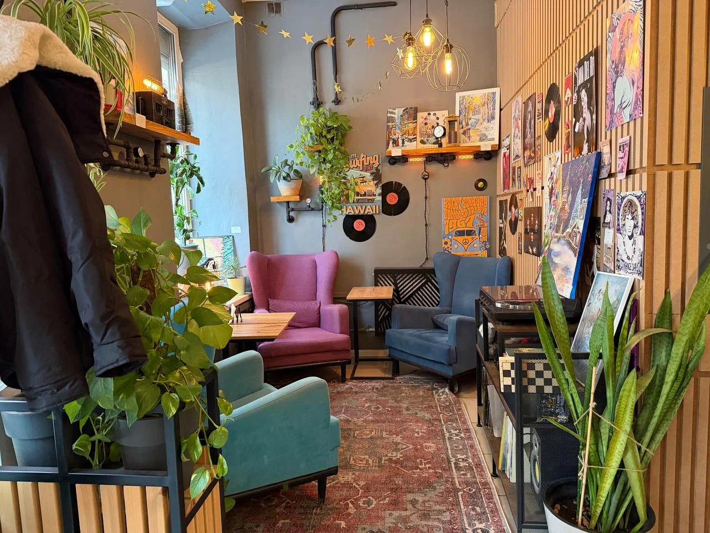

# Весомость Пустоты

## Предисловие автора

Дорогой читатель,

Я пишу эти строки сядя в уютной кофейне, глядя на стенку над соседним креслом. На ней: механические часы, которые не ходят уже лет двадцать; виниловые пластинки и картины.

Ни одна из этих вещей не стоит дороже тысячи рублей. Ни одна не говорит о статусе.

И именно поэтому я их люблю.

Я помню время — и вы, наверное, тоже помните, — когда человека оценивали по обёртке. Часы за полмиллиона. Костюм определённого бренда. Марка машины. Квадратные метры. Всё это работало как язык: я показываю тебе вещи, а ты считываешь, сколько я стою. Не кто я. Не что я чувствую. Не что я умею и что меня ранит. А сколько.

Этот язык умирает. Прямо сейчас. На наших глазах.

Я вижу это по своим студентам, по племянникам, по двадцатилетним ребятам, которые заходят в кофейню в растянутом свитере и с телефоном пятилетней давности — и им не стыдно. Им не нужно доказывать. Они оценивают друг друга не по логотипам. Они спрашивают: «А что ты делаешь? А что тебе интересно? А как ты справился с тем, что тебя сломало?» Внутреннее стало важнее внешнего. И это не мода. Это сдвиг тектонических плит.

А дальше будет ещё интереснее.

Мы стоим на пороге миров, где общение всё больше уходит в виртуальные пространства. Где встречи в мессенджерах, в совместных цифровых комнатах, в тактильных Сферах становятся нормой. И вот что это значит: когда ты встречаешь человека в виртуальном мире, ты можешь выглядеть как угодно. Хочешь — будь светящимся силуэтом. Хочешь — облаком. Хочешь — точкой света, которая пульсирует в такт твоим словам. Внешний вид становится *выбором*, а не приговором. Не тем, что тебе выдали гены и бюджет. А тем, что ты создаёшь прямо сейчас, под настроение, под разговор.

И в этот момент дорогие часы, брендовые костюмы, идеальная причёска — всё это теряет смысл как маркер. Потому что в Сфере у всех часы идеальны. У всех костюм от лучшего портного. У всех лицо симметричное. И что тогда? Тогда остаётся только одно: **что ты говоришь. Как ты думаешь. Чем ты делишься.** Голос. Мысль. Присутствие.

Физические атрибуты успеха обесцениваются не потому, что кто-то их запретил. А потому, что они перестают быть *информацией*. Они больше ничего не сообщают о человеке. А то, что не несёт информации, становится шумом.

Но.

И вот это «но» для меня самое важное.

Не всё уйдёт в цифру. Не должно. Не может.

Потому что мы — тела. Мы дышим. Мы трогаем. Мы чувствуем запах.

Останутся пластинки. Не потому что звук лучше — он не лучше, и любой аудиофил это подтвердит. А потому что это ритуал. Достать из конверта. Опустить иглу. Услышать, как потрескивает пыль в дорожке. Почувствовать, что ты *здесь*, в этой комнате, в этом вечере, и никуда не спешишь.

Останется ламповый усилитель. Не потому что он эффективнее транзистора. А потому что он *греет*. Буквально. Лампы светятся тёплым оранжевым светом. И этот свет — часть музыки.

Останется запах старых книг. Шершавость бумаги. Ощущение, когда переворачиваешь страницу и пальцы чуть липнут к типографской краске. Никакой экран это не передаст. Потому что это не информация. Это *тело*.

Останется недоделанная шкатулка на полке. С царапиной. С тремя нотами вместо двенадцати. С историей чьей-то руки, которая дрогнула и не стала переделывать. Потому что в мире, где ИИ сгенерирует миллион идеальных шкатулок за секунду, одна незаконченная, живая, поцарапанная — это не мусор. Это доказательство, что кто-то был здесь. Жил. Ошибался. Оставлял следы.

Я не пишу утопию. Я не говорю, что будущее будет безоблачным. Я не знаю, что за горизонтом событий — никто не знает. Мы используем новые технологии на двадцать процентов. Может, на пятнадцать. А что будет, когда на семьдесят? Когда на девяносто? Я не знаю. И мне это интересно, а не страшно.

Но я верю в одну простую вещь: технологии не заменят нам тяжесть. Не заменят запах. Не заменят ощущение, когда берёшь в руки чужую, неидеальную, тёплую вещь и чувствуешь чужую жизнь на кончиках пальцев.

Они освободят нас от мусора. От гонки. От необходимости доказывать. От бесконечного шума.

А взамен вернут нам тишину. Вес. Паузу. Три ноты, которые обрываются, потому что четырёх штифтов не хватает.

И это будет достаточно.

А теперь — история.

*— Автор*

## Часть первая. Дом из вещей

Элиан стоял на пороге и не мог войти.

Дом деда смотрел на него сотней тёмных окон, из которых торчали края картонных коробок, сломанные антенны, мотки проводов. Крыша просела под весом солнечных панелей первого поколения — тех, громоздких, с КПД в жалкие двенадцать процентов. Их уже лет двадцать как не ставили. Но дед снял их только наполовину. Вторая половина так и осталась ржаветь, придавливая черепицу.

— Аур, сколько тут объектов? — спросил Элиан в пустоту.

Голос пришёл не из наушника и не из динамика. Он возник прямо в слуховом нерве, мягкий, тёплый, с лёгким оттенком терпеливой иронии. Аур связывалась с ним через нейрошунт третьего поколения — тончайшую нить в височной кости, подключённую к орбитальному кластеру «Цирцея-7». Где-то в четырёхстах километрах над головой солнечные паруса размером с футбольное поле питали серверы, которые прямо сейчас думали за Элиана.

— Три тысячи двести четырнадцать физических объектов, — ответила Аур. — Семьдесят восемь процентов классифицированы как устаревшая электроника. Двенадцать процентов — текстиль. Шесть процентов — бумага. Четыре процента — неопределяемое.

— Неопределяемое?

— То, что не поддается логической категоризации с точки зрения утилитарной ценности. Дед хранил сломанные вещи. Просто хранил.

Элиан вздохнул. Ему тридцать два. Он работал Синтезатором — помогал людям и семьям переходить через разрывы эпох. Перестраивал квартиры, переносил архивы, объяснял бабушкам, почему их коллекция фарфоровых слоников больше не требует отдельной комнаты. Он делал это каждый день. Но это был чужой хлам. Чужие эпохи.

А здесь — дед.

Он шагнул внутрь.

Запах ударил сразу: пыль, машинное масло, старая бумага, пластик, разлагающийся где-то в глубине шкафов. Воздух был густой, почти осязаемый. В прихожей стояли три пары ботинок, которые никто не носил минимум пятнадцать лет. На вешалке — семь курток. На полке — ключи от машин, которые давно отправились в переработку.

Элиан шёл через комнаты, и каждая была как геологический срез. Вот кухня: три микроволновки разных лет. Вот гостиная: телевизор с плоским экраном, который в своё время казался чудом, а теперь выглядел как надгробная плита. Стеллажи с дисками. Полки с зарядными устройствами для телефонов, которых не существует.

Это была Эпоха Потребления в чистом виде. Не злая. Не циничная. Просто... голодная. Дед покупал, потому что мог. Потому что покупка была актом веры: завтра будет лучше, чем сегодня, и мне понадобится новая вещь, чтобы это почувствовать.

— Аур, запусти протокол сортировки. Стандартный. Утилизация, переработка, архив.

— Принято. Отправляю запрос на андроидов-логистов. Прибудут через четыре часа.

Четыре часа. Элиан сел на диван, продавленный до металлического каркаса. Вокруг него громоздилась жизнь деда. Вещи. Тысячи вещей. Каждая когда-то была нужна. Каждая когда-то радовала. А теперь они давили. Не физически — ментально. Словно сам воздух в доме был пропитан чужим желанием обладать.

Он закрыл глаза. Где-то на орбите «Цирцея-7» ловила солнечный ветер и превращала его в мысли. Где-то в городе его собственная квартира ждала его: белые стены, одно растение, один стол, один стул. Ничего лишнего. Эпоха Осознанного Потребления. Эпоха его поколения.

Но здесь, в этом доме, было что-то ещё. Что-то, что не давало просто вызвать утилизаторов и уйти.

Элиан встал и пошёл в дальнюю комнату. В мастерскую.

---

## Часть вторая. Шкатулка

Мастерская была единственной комнатой, где царил не хаос, а странный, интуитивный порядок. На верстаке лежали инструменты — настоящие, стальные, с деревянными ручками, отполированными ладонями. Рубанок. Стамески. Надфили. Ряды напильников, каждый в своём гнезде.

А в центре верстака, под слоем пыли, стояла шкатулка.

Элиан сдул пыль. Дерево — тёмное, с рыжими прожилками. Крышка не закрывалась до конца: механизм внутри был не закончен. Он повернул шкатулку в руках. Тяжёлая. Граммов триста. На дне — царапина. Глубокая, случайная. След ножа, соскользнувшего с руки.

— Аур, сканируй.

Пауза. Longer than usual.

— Объект: механическая музыкальная шкатулка. Ручная работа. Незавершена. Тридцать семь шестерёнок из латуни. Пружинный механизм. Валик с двенадцатью дорожками. Не хватает четырёх штифтов для полной мелодии. Дерево — орех, возраст приблизительно сорок лет. Царапина на нижней панели: след случайного соскальзывания лезвия. Глубина — ноль миллиметров, три десятых.

— Дед её делал.

— Вероятность девяносто четыре процента, основываясь на следах инструментов и ДНК-микрочастицах на рукоятках.

Элиан провёл пальцем по царапине. Неровной. Неидеальной. Живой.

В его мире не было таких вещей. Всё было спроектировано ИИ, напечатано на молекулярных принтерах, идеально, безупречно, одноразово. А здесь — ошибка. Соскользнувший нож. И дед не выбросил шкатулку. Не начал заново. Оставил шрам.

Он положил шкатулку в карман куртки. Тяжесть приятно оттянула ткань.

— Аур, отмени утилизацию для этого объекта. Переведи в категорию «личное наследие».

— Выполнено. Элиан, хочу отметить: объект не имеет рыночной стоимости. Не имеет утилитарной функции. Не завершён. В рамках Протокола Осознанного Потребления рекомендация — переработка.

— Я знаю.

— Но ты оставляешь.

— Да.

Аур молчала две секунды. Для ИИ, работающего на орбитальном кластере, это была вечность.

— Зафиксировано как иррациональное решение. Добавляю в твой профиль как «эмоциональный якорь». Не осуждаю.

Элиан усмехнулся. Вышел из дома. За спиной три тысячи двести четырнадцать объектов ждали своих утилизаторов. А в кармане лежали триста грамм незавершённой музыки.

---

## Часть третья. Аналоговый Ковчег

Вечером Элиан не пошёл домой. Он пошёл в Подвал.

Так называли его завсегдатаи. Официально это было «Пространство Тактильного Опыта номер четырнадцать», но никто так не говорил. Подвал находился в бывшем подземном паркинге торгового центра «Меридиан» — того самого, который закрылся восемь лет назад, когда последний человек понял, что ему не нужно ехать в здание, чтобы купить то, что ИИ доставит за двадцать минут.

Теперь на поверхности «Меридиана» рос парк. Настоящий. С дубами, которые посадили в день закрытия магазина. С прудом, где цвели кувшинки. С андроидами-садовниками, которые каждое утро подрезали живые изгороди своими мягкими полимерными пальцами.

А внизу — Подвал.

Элиан спустился по лестнице. Дверь была деревянная, тяжёлая, с настоящим замком. Внутри пахло канифолью, нагретым металлом и чем-то сладковатым — кто-то варил кофе. Не в синтезаторе. В турке. На огне.

За длинным столом сидели человек пятнадцать. Кто-то паял плату — настоящую, с оловянным припоем, а не молекулярной сваркой. Кто-то крутил ручку настройки лампового приёмника. В углу девушка лет двадцати вырезала ложку из куска берёзы, и стружка падала ей на колени.

— Элиан! — окликнул его старик за верстаком. Мастер Ковч, так его звали. Семьдесят лет, руки как кора дуба. — Принёс?

Элиан достал шкатулку. Положил на стол.

Ковч взял её. Перевернул. Провёл пальцем по царапине. Прищурился.

— Ручная. Не закончена. Но дышит.

— Что значит «дышит»?

Ковч усмехнулся.

— Цифра не дышит, парень. В Сфере ты можешь создать идеальную шкатулку. Каждый атом на месте. Каждая шестерёнка — шедевр. Но она не пахнет орехом. Не скрипит, когда поворачиваешь крышку. Не царапает ладонь. А это — Ковч постучал ногтем по дереву, — это делает. Это *есть*.

Он открыл шкатулку. Валик щёлкнул. Три шестерёнки повернулись. Из механизма вырвался обрывок мелодии — три ноты, чистые, дрожащие, металлические. А потом тишина. Четырёх штифтов не хватало. Мелодия обрывалась на полуслове.

— Красиво, — сказал Ковч. — Даже сломанная. Может, особенно сломанная.

Элиан сел рядом. Вокруг шумел Подвал: потрескивание ламп, шипение паяльника, мягкий стук деревянной ложки о край стола. На полке у стены стоял проигрыватель. Ковч подошёл, достал из бумажного конверта пластинку — чёрную, тяжёлую, с бумажной этикеткой. Опустил иглу.

Звук заполнил пространство. Не идеальный. Не чистый. Тёплый. С лёгким треском на переходах. С шипением в паузах. С неровностью, которая делала каждую ноту *случившейся*, а не *сгенерированной*.

— Почему вы это слушаете? — спросил Элиан. Не с вызовом. С любопытством. — В Сфере любой звук идеален. Любая частота. Любая глубина.

Ковч покачал головой.

— Ты не понимаешь. Мы не слушаем звук. Мы слушаем *время*. Царапина на пластинке — это кто-то поставил её в семьдесят третьем. Пыль в дорожке — это чей-то вечер. Игла дрожит не потому что запись плохая. А потому что это *физическое касание*. Алмаз касается бороздки. Молекула к молекуле. В Сфере нет касания. Там есть симуляция касания. А это — настоящее.

Пластинка потрескивала. Ламповый усилитель гудел тёплым, медовым гулом. Элиан слушал и чувствовал, как что-то в груди, затянутое годами работы с протоколами и алгоритмами, медленно разжимается.

Он достал шкатулку. Провёл пальцем по царапине.

— Что мне с ней делать?

Ковч пожал плечами.

— А что ты хочешь?

— Не знаю. Выбросить — рука не поднимается. Хранить у себя — зачем? Она не играет. Она не закончена. Она... просто есть.

— Вот именно, — сказал Ковч. — Она просто есть. В этом и ценность. В мире, где ИИ может сгенерировать миллион идеальных шкатулок за секунду, одна незаконченная, поцарапанная, сделанная руками человека, который ошибся и не стал переделывать, — это артефакт. Это доказательство, что кто-то жил. Неоптимально. Неэффективно. Но жил.

---

## Часть четвёртая. Горизонт Событий

Через неделю Элиан сидел в своей квартире. Белые стены. Одно растение. Один стол. Шкатулка лежала перед ним.

— Аур.

— Да.

— Мы используем орбитальные кластеры на двадцать процентов мощности. Так?

— Двадцать три, если считать пассивные процессы. Активное использование — около семнадцати.

— А если бы на семьдесят? Что бы изменилось?

Пауза. На этот раз длиннее.

— Элиан, ты спрашиваешь о переходе за горизонт событий. О качественном скачке. Я могу смоделировать варианты, но... это будет не прогноз. Это будет фантазия. Мы не знаем, что там. Как не знает физик, что за горизонт чёрной дыры. Уравнения работают до определённой точки. А дальше — сингулярность.

— Пофантазируй.

— Если мы перейдём от оптимизации существующих процессов к генерации принципиально нового опыта... Виртуальное потребление перестанет быть «имитацией реального». Оно станет *параллельной реальностью* с собственной физикой, собственной эстетикой, собственными законами. Не копия. Не симуляция. А *другое*.

— И что тогда станет с физическим миром?

— Он станет тем, чем должен быть. Садом. Храмом. Местом, куда приходят за тишиной, за тяжестью, за запахом земли. Виртуальное заберёт у него всё лишнее: потребность в новизне, в развлечении, в бесконечном выборе. А оставит ему только то, что нельзя оцифровать.

— А что нельзя оцифровать?

Аур молчала. Потом:

— Царапину, которую оставил твой дед. Не саму царапину — её можно отсканировать с точностью до атома. А *историю руки, которая дрогнула*. *Момент удивления*, когда он увидел след и решил не переделывать. Это не информация. Это *переживание*. И оно привязано к материи. К конкретному куску ореха. К конкретному лезвию. К конкретному вечеру.

Элиан взял шкатулку. Поднёс к уху. Потряс. Шестерёнки тихо звякнули внутри. Металл о металл. Настоящий звук. Не идеальный. Тёплый.

— Аур. Я хочу, чтобы эта шкатулка была в двух местах одновременно. В физическом и в Сфере. Но не как копия. Как... диалог.

— Объясни.

— В Сфере — она бесконечна. Можно войти внутрь механизма. Можно изменить гравитацию и слушать, как шестерёнки звучат в невесомости. Можно достроить мелодию, добавить сто штифтов, тысячу. Бесконечность.

— А в физическом мире?

— В физическом мире она стоит в парке. На полке из живого дерева. И любой человек может взять её в руки. Почувствовать вес. Увидеть царапину. Понять, что кто-то жил. Ошибался. Не переделал. Оставил как есть.

— Два объекта. Два опыта. Одна шкатулка.

— Да.

— Это потребует нового типа пространства. Не музей. Не парк. Не галерея. Что-то четвёртое.

— Я знаю. Я хочу его построить.

---

## Часть пятая. Сад Тёплых Артефактов

Через восемь месяцев Элиан стоял посреди того, что раньше было парковкой на две тысячи четыреста мест.

Теперь здесь был Сад.

Не парк в старом понимании. Не музей. Не торговый центр. Не галерея. Что-то новое. Что-то, для чего ещё не придумали слово, но Элиан называл его **Живая Галерея**.

Деревья росли сквозь архитектуру. Стены были из биокомпозита — тёплого, пористого, похожего на песчаник, но выращенного из мицелия и переработанного пластика. По стенам вился плющ. В трещинах между плитами пробивалась трава.

Вдоль дорожек стояли постаменты. Не стеклянные витрины. Не пьедесталы. Просто куски дерева, камня, глины. На них лежали предметы. Настоящие. Тактильные.

Вот чугунный утюг. Рядом табличка, вырезанная из дерева: *«Возьми в руки. Почувствуй вес. Это вес чьего-то утра».*

Вот механические часы. Стрелки идут. Можно поднести к уху и услышать тиканье. Рядом, через нейролинзы, видна история: мастер, который их собирал. Его руки. Его дыхание. Но это — *дополнение*. Не замена. Часы работают и без линз. Они просто тикают.

Вот керамическая чашка. Неровная. С потёком глазури. Можно налить в неё чай из самовара, который стоит тут же, нагретый настоящим углём. Можно пить. Обжечь губы.

Андроиды-садовники двигались между посетителями бесшумно. Не обслуживали. Не навязывались. Поливали растения. Подметали опавшие листья. Иногда останавливались у постамента и смотрели на предмет. Просто смотрели. Элиан не знал, что они видят. Может, ничего. Может, для них это было формой созерцания.

В центре Сада стояло дерево. Старый дуб, который рос здесь ещё до парковки. До торгового центра. До Эпохи Потребления. Его корни взломали бетон десятилетия назад. Теперь он стоял в круге из живой травы, и его ветви поддерживали тонкую конструкцию из солнечных нитей, которые питали локальный узел Сферы.

Под дубом, на полке из необработанного ореха, стояла шкатулка.

Элиан подошёл. Провёл пальцем по царапине.

В Сфере, прямо сейчас, миллионы людей входили внутрь её механизма. Строили бесконечные мелодии. Меняли гравитацию. Слушали, как латунь звучит в вакууме. Бесконечность. Игра. Творчество без границ.

А здесь — триста грамм дерева и металла. Царапина. Незаконченная мелодия. Три ноты, если повернуть валик. И тишина.

Женщина с ребёнком подошла к полке. Мальчик, лет пяти, протянул руку.

— Можно?

— Можно, — сказал Элиан.

Мальчик взял шкатулку. Повертел. Нахмурился. Повернул валик. Три ноты. Чистые. Дрожащие. Металлические.

— Она сломана? — спросил мальчик.

— Нет, — сказал Элиан. — Она не закончена. Это разные вещи.

Мальчик подумал. Прижал шкатулку к уху. Послушал, как внутри тихо звякают шестерёнки.

— А кто её делал?

— Мой дед.

— А почему не доделал?

Элиан задумался.

— Может, понял, что не нужно. Может, устал. Может, хотел, чтобы кто-то другой когда-нибудь взял её в руки и спросил именно этот вопрос.

Мальчик вернул шкатулку на полку. Аккуратно. Погладил крышку. И побежал к пруду, где андроид-садовник пускал по воде кораблики из листьев.

Женщина посмотрела на Элиана.

— В Сфере я могу создать миллион таких шкатулок. Идеальных. С полной мелодией.

— Знаю.

— Но я привела его сюда. Чтобы он взял в руки *эту*. Одну. Неидеальную. Чужую.

— Да.

Она помолчала.

— Это и есть потребление будущего? Не владеть миллионом. А коснуться одного?

Элиан посмотрел на шкатулку. На царапину. На три ноты, которые не складывались в мелодию, но были живыми.

— Я думаю, потребление будущего — это *присутствие*. Быть здесь. С этим. В этом теле. В этом запахе. В этой тяжести. А бесконечность... — он кивнул вверх, туда, где за голубым небом мерцали невидимые орбитальные паруса, — бесконечность подождёт. Она никуда не денется. Она всегда с нами. А вот это — Элиан коснулся шершавой поверхности полки, — это бывает только раз.

---

## Эпилог. Тёплый гул

Вечером Элиан сидел в Подвале. Ковч ставил новую пластинку. Ламповый усилитель гудел медовым теплом. Кто-то в углу вырезал из дерева маленькую лодочку. Стружка падала на пол.

На столе лежала шкатулка. Элиан вернул её из Сада на один вечер. Завтра она поедет обратно, на свою полку под дубом. А сегодня — просто лежала здесь. Среди ламп и канифоли.

Ковч налил ему кофе. Из турки. Горячий. Горький. Настоящий.

— Знаешь, что я понял? — сказал Элиан, обхватывая чашку ладонями.

— Что?

— Мы боялись, что технологии заберут у нас мир. Что ИИ, что андроиды, что Сфера — что всё это сделает нас ненужными. Отнимет у нас *реальность*.

— А они?

— Они забрали у реальности *лишнее*. Конвейер. Мусор. Гонку. Тревогу. Бесконечный выбор, от которого тошнит. А взамен вернули ей вес. Тяжесть. Паузу. Возможность просто сесть и послушать, как тикают часы. Или как скрипит дерево под рубанком. Или как три ноты обрываются в тишину, потому что четырёх штифтов не хватает. И это нормально.

Ковч усмехнулся. Поднял свою чашку.

— За три ноты.

— За три ноты, — повторил Элиан.

Пластинка потрескивала. Лампы гудели. Где-то наверху, за бетонным потолком Подвала, в парке на месте торгового центра, андроид-садовник поливал дубы. А на орбите «Цирцея-7» ловила последний солнечный свет и превращала его в бесконечные миры, которые ждали утра.

Элиан допил кофе. Поставил чашку. Керамика стукнула о стол. Тихо. Тепло. Неровно.

Живо.

---

*Конец.*
